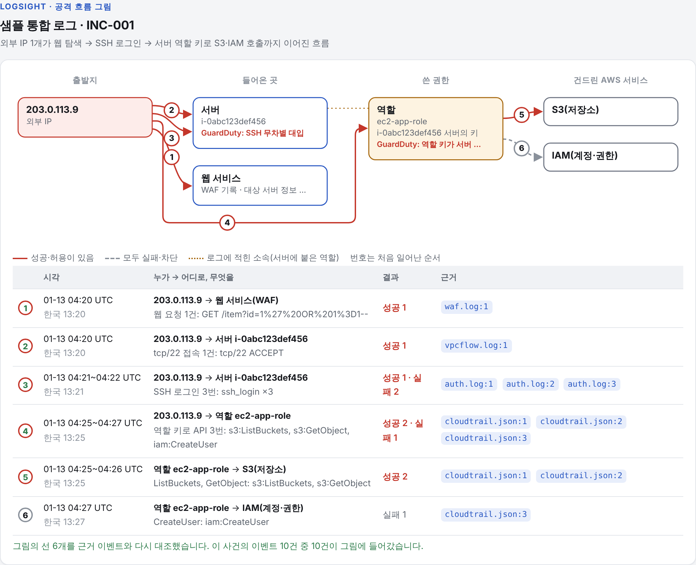

# LogSight

흩어진 AWS 로그(CloudTrail, VPC Flow Logs, AWS WAF, ALB, SSH 인증 로그)를 하나의 공격 흐름으로 엮어
한국어로 설명하고, 원인 설정과 보안그룹·NACL·WAF·IAM 수정안을 제안하는 보안 분석 도우미.
AI:ON 2026 출품작(팀 로그파인더).

**GuardDuty 대신이 아니라 GuardDuty 다음에 쓰는 도구.** GuardDuty는 24시간 감시하다 경보를 주지만,
켜기 전의 일과 웹·서버 안쪽(ALB·WAF·웹서버·SSH 로그)은 보지 않는다. LogSight는 GuardDuty 결과와 이 로그들을
한 사건으로 엮어 "어떻게 들어왔고 어디를 고칠지"를 근거와 함께 보여 준다. 사고가 없는 평소에는
`logsight check`로 그때 필요한 로그가 켜져 있는지 점검한다. 근거: [GuardDuty_비교.md](docs/GuardDuty_비교.md)

| 언제 | 무엇을 | 도구 |
| --- | --- | --- |
| 평소 | 경보 받기 | GuardDuty(켜 두기) |
| 평소 | 사고 때 쓸 로그가 켜져 있는지 점검 | `logsight check` |
| 경보가 울린 날 | GuardDuty 결과 + 웹·서버 로그로 원인과 고칠 설정 찾기 | `logsight analyze` |

## 빠른 실행

    python -m venv .venv
    # macOS/Linux: source .venv/bin/activate    Windows: .venv\Scripts\activate
    pip install -r requirements.txt
    python -m logsight analyze samples/demo --out reports/demo
    # reports/demo/report.html 을 브라우저로 연다
    python -m logsight analyze samples/combined --out reports/combined   # 로그 8종을 한 폴더에 넣은 예

웹 데모: `uvicorn app:app --reload` → http://127.0.0.1:8000. 로그 파일 여러 개를 한 칸에 올리면 종류를 자동으로 알아본다(environment.json도 같이). 샘플 바로 보기: /demo?sample=demo|free|combined

### 웹서버 침해 판단 (신규)

"우리 웹서버, 이미 뚫렸나?"를 **서버에 쌓인 로그·파일만으로** 판단하는 기능. nginx/Apache
접속·오류 로그, 리눅스 인증 로그, 웹 루트 파일(웹셸)을 보고 침입 흐름을 복원해 판정한다.

    # 저장소에 포함된 샘플로 바로 (서버 불필요)
    python -m logsight scan --profile samples/web/profile.json --no-ai --out reports/web_demo
    # 실제 사이트: profile.json 하나만 바꾼다 (경로/웹루트/신뢰 IP)
    python -m logsight scan --profile profile.json --out reports/mysite

웹 화면·API: `uvicorn app:app` → http://127.0.0.1:8000/web , JSON API는 `/api/web/scan`.
설계·검증·한계는 `docs/웹서버_침해판단_설계.md`, 로컬 검증 환경은 `lab/README.md` 참고.

Claude 분석을 켜려면 `ANTHROPIC_API_KEY`를 환경변수로 설정한다(.env.example 참고, 키는 커밋 금지).
키가 없거나 호출이 실패하면 같은 형식의 규칙 기반 보고서를 만든다. 모델은 `LOGSIGHT_MODEL`
(기본 `claude-haiku-5-5`)로 바꾼다. 키가 있으면 상세 분석 전에 사건 전체를 한 번 재검토해
공격으로 보이는 사건을 위로 올리고 같은 공격의 사건들을 묶는다(`logsight/triage.py`, 모델은
`LOGSIGHT_TRIAGE_MODEL`, 기본 `claude-opus-5-5`). 재검토는 순서만 바꾸고 사건을 지우지 않는다.
Python 3.10 이상 필요.

## 처리 흐름

    로그 파일/폴더(.json/.log/.gz)
      → normalize.py   형식 자동 판별, 파서 5종, 공통 스키마(Event)
      → detect.py      규칙 기반 1차 탐지 20종, MITRE ATT&CK 기법 대응
      → correlate.py   의심 이벤트를 IP·인스턴스·IAM 주체·액세스 키로 묶어 사건 생성(networkx)
                       나머지 이벤트는 맥락 집계로만 요약, 내보내는 데이터 마스킹
      → config_audit.py 설정 스냅샷(environment.json)과 대조해 원인 설정·수정안·AWS CLI 생성
      → analyze.py     Claude 구조화 출력(JSON 스키마) → 근거(ref)가 실제 입력에 있는지 코드로 검증
      → graph.py       공격 흐름 그림: 근거 이벤트로만 선을 긋고, 모든 이벤트가 그림에 들어갔는지 다시 대조
      → report.py      한 파일짜리 HTML 보고서(오프라인 시연 가능)

원칙: 원본 로그를 통째로 AI에 보내지 않는다. 모든 판단에 근거 위치(파일:줄)를 붙인다.
그림도 같다. 로그에 이어진 기록이 없으면 선으로 잇지 않는다(예: 웹 요청 로그에 대상 서버가 없으면 웹 서비스와 서버를 따로 둔다).


수정안은 자동 적용하지 않는다(사람이 검토 후 직접 적용).

## 명령

    python -m logsight analyze <파일|폴더...> [--env environment.json] [--top 5] [--no-ai] [--model ID]
    python -m logsight analyze <폴더> --since 2017-02-12 --until 2017-02-13   # 기간만(기간 밖 파일은 읽지 않음)
    python -m logsight analyze <폴더> --dry-run   # Claude에 보낼 내용(마스킹 후)만 ai_payload.json으로 저장
    python -m logsight analyze guardduty_findings.json <다른 로그...>   # GuardDuty 탐지 결과도 함께 분석
    python -m logsight analyze <폴더> --syslog-tz +09:00 --year 2026   # auth.log·kern.log처럼 연도·시간대 없는 줄의 해석
    python -m logsight rules              # 탐지 규칙 목록
    python -m unittest discover -s tests  # 테스트
    python scripts/bench.py 200000        # 대용량 처리 시간 측정

폴더 안에 environment.json이 있으면 자동으로 설정 점검에 쓴다. 없으면 로그만으로 분석한다.

### AI 없이 쓰기(규칙 기반 모드)와 정상 작업 목록

API 키가 없거나 `--no-ai`면 Claude를 부르지 않고 끝까지 동작한다. 로그는 컴퓨터 밖으로 나가지 않고, 같은 입력이면 항상 같은 결과가 나온다.
보고서 맨 위에 "AI 사용 안 함" 또는 "Claude 사용"이 표시된다.

- 사건 판정: 공격 의심 / 공격 아님·위험 설정 / 판단 불가 / 정상 활동을 규칙으로 정하고 공격 의심을 위로 올린다(`logsight/explain.py`).
- 설명 문장: 탐지 규칙마다 "누가, 무엇을, 몇 번, 성공·거부 몇 건, 왜 중요한가"를 쓰는 문장 틀이 있다.
- 로그 범위: 로그 종류별 기간을 막대로 보여 주고, 없는 로그·먼저 끝난 로그·S3 데이터 이벤트 0건처럼 "이 로그로는 알 수 없는 것"을 적는다.
- 정상 작업 목록: environment.json에 운영자·배포 계정·관리 IP를 적으면 그 활동만으로 된 사건을 "정상 활동"으로 내린다. 사건을 지우지 않고 순서만 바꾼다. `trusted_ips`도 목록으로 쓴다.

```json
"known_activity": [
  {"label": "배포 자동화(CI)", "actors": ["github-actions-deploy", "*-deploy-role"]},
  {"label": "모니터링 서버", "ips": ["10.0.9.5/32"]},
  {"label": "백업 키", "access_keys": ["AKIA..."]}
]
```

`actors`는 IAM ARN 전체나 마지막 이름에 `*` 패턴으로 맞춘다. 목록의 계정이 도용되면 공격을 정상으로 볼 수 있으므로 목록은 좁게 쓴다.

같은 사건을 규칙과 Claude로 나란히 보는 화면: `python scripts/compare_modes.py --col "규칙=report.json:rule_triage" --col "Claude=report.json:triage"` (웹 데모는 `/compare`).

## 분석 전에: 로그가 켜져 있는지 점검하고 켜기

작은 팀은 분석할 로그가 아예 꺼져 있는 경우가 많다(추정). `pip install boto3` 후:

    python -m logsight check                          # 읽기 전용 점검: 꺼진 로그, 비용, 무료 대안, 켜는 명령
    python -m logsight check --apply CT_TRAIL VPC_FLOW GUARDDUTY   # 확인('yes') 후 지정 항목만 켜기
    python -m logsight collect environment --out environment.json  # 보안그룹·NACL·WAF·IAM 설정 자동 수집
    python -m logsight collect cloudtrail-history --days 30 --out logs/ct.json  # 무료 90일 이벤트 기록
    python -m logsight cost --web-requests 3000000    # 로그를 켰을 때 월 비용 어림셈

돈이 드는 로그의 무료 대안:

| 유료 | 무료 대안 | 분석 방법 |
| --- | --- | --- |
| CloudTrail 추적 | CloudTrail 이벤트 기록(최근 90일) | `collect cloudtrail-history` |
| VPC Flow Logs | 서버 방화벽 로그 | 서버에서 `sudo bash scripts/setup_hostfw_log.sh` → `kern.log` 분석 |
| AWS WAF 로그 | nginx/apache 접속 로그 | `access.log` 그대로 분석 |

자세한 내용: [docs/로그_점검과_무료대체.md](docs/로그_점검과_무료대체.md), 남은 문제 해결 방안: [docs/해결방안_조사.md](docs/해결방안_조사.md)

## flaws.cloud 공개 데이터셋으로 돌리기

summitroute.com에서 `flaws_cloudtrail_logs.tar`(약 240MB)를 받아 풀고:

    tar -xf flaws_cloudtrail_logs.tar -C data/
    python -m logsight analyze data/flaws_cloudtrail_logs --top 10 --no-ai --out reports/flaws

이 데이터셋의 IP는 익명화되어 있어 파이프라인 동작·규모 검증용으로 쓴다.
194만 건 전체는 메모리를 2GB 안팎 쓸 수 있으니 처음에는 파일 몇 개로 시작한다.

## 폴더

    logsight/        분석 엔진
    app.py           FastAPI 웹 데모
    samples/demo/    작은 샘플 로그 4종 + 설정 스냅샷 예시
    samples/combined/ 로그 8종을 한곳에 모은 합성 샘플(정규화 점검용)
    tests/           단위·통합 테스트(171개)
    scripts/         성능 측정
    reports/demo/    샘플 분석 결과(HTML, JSON, 화면 캡처)
    reports/combined/ 8종 통합 분석 결과
    docs/            중간보고서용 구현 요약, 발표 자료(중간보고_발표자료.md)
    .github/workflows/test.yml  Windows·macOS·Linux 자동 테스트(저장소에 올리면 동작)

## 라이선스

MIT 라이선스. 자세한 내용은 `LICENSE` 파일을 보세요. 변경 기록은 `CHANGELOG.md`에 있습니다.

MIT 라이선스는 이 저장소의 코드에만 적용됩니다. 성능 측정에 쓴 외부 데이터셋은 저장소에 들어 있지 않고, 각 데이터셋의 라이선스를 따릅니다.

This project utilizes the AIT Log Data Set V2.0 (AIT-LDSv2) provided by M. Landauer et al. (AIT Austrian Institute of Technology), licensed under CC BY-NC-SA 4.0 (https://doi.org/10.5281/zenodo.5789064), for non-commercial evaluation only. 인용과 측정 결과는 `docs/공개데이터셋_독립측정.md`를 보세요.

실제 AWS 계정 로그 측정에는 Splunk BOTSv3(https://github.com/splunk/botsv3, CC0)를 썼습니다. 결과는 `docs/BOTSv3_측정.md`를 보세요.

## CTF 로그로 탐지 성능 재기

동아리 CTF 등 허가된 환경에서 나온 로그로 판정 성능을 재는 방법은 `docs/CTF_로그_수집_가이드.md`를 보세요.
