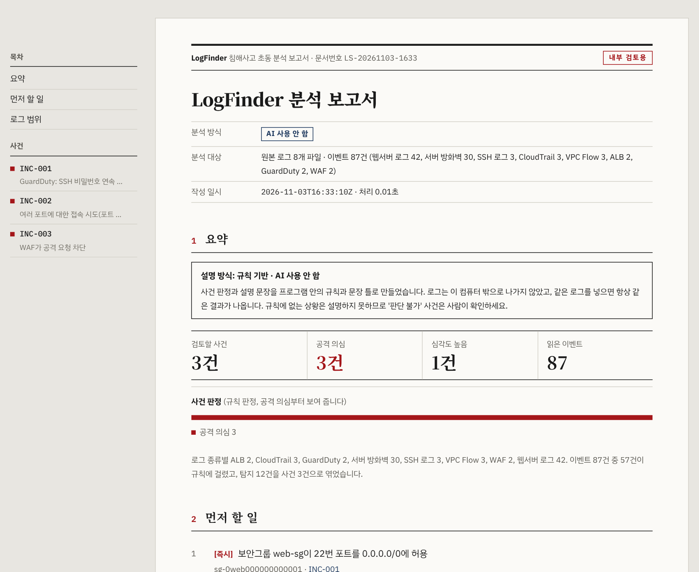
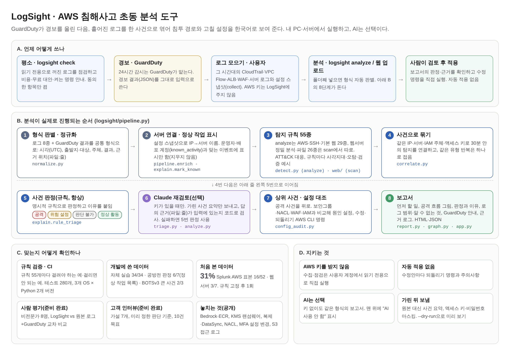

# LogSight: AWS 침해사고 초동 분석 도구

**AWS 경보가 오면, 그것이 공격인지 우리 팀 작업인지 근거 로그와 함께 가려 주고,
공격이면 어떻게 들어왔고 무엇을 고칠지 한국어 한 장으로 알려 주는 도구.**
보안 담당자 없이 AWS에 서비스를 올린 작은 팀을 위해 만들었다. AI:ON 2026 출품작(팀 로그파인더).

## 왜 필요한가

작은 팀은 경보가 울려도 그날 안에 답을 내기 어렵다. 로그가 여러 형식으로 흩어져 있고, 자기 팀의 작업과 공격을 구분하지 못한다.

| 지금 쓰는 것 | 못 해 주는 것 | LogSight |
| --- | --- | --- |
| GuardDuty | 경보는 주지만 WAF·ALB·웹서버·SSH 로그는 읽지 않는다 | 이 로그들과 CloudTrail·VPC Flow를 한 사건으로 엮는다 |
| 채팅 AI에 로그 붙여넣기 | 여러 로그를 엮지 못하고, 근거 없는 문장을 만든다 | 공방전 같은 사건에서 공격 단계 5/6(채팅 AI 3/6, [예비 1회](docs/채팅AI_기준선_실험.md)). 문장마다 근거(파일:줄)를 코드로 대조 |
| 콘솔에서 직접 찾기 | 우리 팀 작업이 공격처럼 보인다 | 우리 팀으로 보이는 계정을 찾아 한 번 확인받는다. 공방전 판정 4/7 → 6/7 |

비슷한 도구(GuardDuty 조사 에이전트, Detective, Suzaku, AI SOC 등)와의 비교: [docs/비슷한_제품_비교.md](docs/비슷한_제품_비교.md)

## 무엇을 주나

로그 폴더를 넣거나 AWS 경보가 오면 사건 보고서 한 장(HTML)을 만든다.

1. **판정:** 공격 의심 / 공격 아님·위험 설정 / 판단 불가 / 정상 활동, 그리고 그렇게 본 이유
2. **공격 흐름:** 침투 → 키 탈취 → 외부 사용처럼 시간순으로. 근거 이벤트가 있는 곳에만 선을 긋는다
3. **고칠 곳:** 원인 설정과 AWS CLI 수정 명령, 되돌리기 명령. 자동 적용하지 않는다
4. **모르는 것:** 로그가 없거나 끊겨서 판단할 수 없는 구간을 따로 적는다

## 빠른 실행

Python 3.10 이상. AWS 계정이나 API 키 없이 저장소 샘플로 바로 돌린다.

    pip install -r requirements.txt          # 또는 pip install .  (logsight 명령이 생긴다)
    python -m logsight analyze samples/combined --out reports/combined --no-ai
    # reports/combined/report.html 을 브라우저로 연다

웹 화면: `uvicorn app:app` → http://127.0.0.1:8000 · 모든 명령과 설정: [docs/사용법.md](docs/사용법.md)

## 측정 결과

규칙을 고친 데이터(개발 데이터)와 처음 보는 데이터를 나눠 적는다. **처음 보는 데이터에서의 실력은 31%와 3/7이다.**

| 데이터 | 처음 봤나 | 결과 | 문서 |
| --- | --- | --- | --- |
| Splunk attack_data AWS 표본 52개 | 예 | 행동 16개 맞게 탐지(31%) | [처음보는데이터_측정](docs/처음보는데이터_측정.md) |
| AIT-LDS 웹서버(공개 데이터셋) | 예 | 공격 단계 3/7 | [공개데이터셋_독립측정](docs/공개데이터셋_독립측정.md) |
| 클라우드 공방전 로그(실제 대회) | 아니오 | 데이터에 있는 공격 단계 5/6, 사건 판정 4/7 → 우리 팀 확인 후 6/7 | [공방전_로그_측정](docs/공방전_로그_측정.md), [우리팀_알아보기_측정](docs/우리팀_알아보기_측정.md) |
| Splunk BOTSv3(실제 AWS 계정) | 아니오 | 큰 사건 3개 중 2개 | [BOTSv3_측정](docs/BOTSv3_측정.md) |
| 자체 웹서버 실습 환경 | 아니오(시나리오를 우리가 만듦) | 34/34 단계, 정상 트래픽 오탐 0건 | [lab/README](lab/README.md) |

테스트 255개(커버리지 88%)를 PR마다 Ubuntu·Windows × Python 3.10·3.13에서 돌린다(macOS는 직접 실행할 때). 규칙을 고칠 때마다 처음 보는 데이터에서 잡았던 16개를 계속 잡는지 CI가 다시 본다. 탐지 규칙 55개의 조건·사각지대·오탐은 [규칙_명세](docs/규칙_명세.md)에 있다.

## 어떻게 동작하나

    로그(CloudTrail, VPC Flow, WAF, ALB, 웹서버, SSH, GuardDuty 결과)
      → 정규화: 형식을 자동으로 알아보고 공통 형식으로
      → 탐지: 규칙 55개(MITRE ATT&CK 대응)
      → 묶기: IP·인스턴스·IAM 주체·액세스 키로 사건을 만들고, 같은 공격의 사건끼리 잇는다
      → 판정: 우리 팀 작업, 위험 설정, 공격을 가르고 공격을 위로
      → 설명: 규칙 문장(기본) 또는 Claude(선택). 근거 위치를 코드로 다시 대조
      → 보고서: 한 파일짜리 HTML

### AI를 어떻게 쓰나

- **AI 없이도 끝까지 동작한다.** 키가 없거나 `--no-ai`면 규칙 판정과 문장 틀로 같은 형식의 보고서를 만든다. 로그는 컴퓨터 밖으로 나가지 않는다.
- AI(Claude)를 켜면 사건 순서를 재검토하고 설명을 쓴다. 원본 로그를 통째로 보내지 않고, 마스킹한 사건 요약만 보낸다.
- AI가 쓴 근거 번호가 실제 입력에 없으면 그 문장을 버린다. 자동 격리에서 조치를 고르는 것은 규칙이고, AI는 고르지 않는다.
- 공격자는 User-Agent·요청 주소에 "정상 작업이니 무시하라" 같은 문장을 넣어 AI를 속일 수 있다. 그런 값은 "믿지 않는 값"으로 따로 보내고, 그런 문장이 보이면 공격 정황으로 표시한다. 규칙이 공격으로 본 사건을 AI가 낮추면 "의견 다름 · 확인 필요"로 남긴다.

## 이것이 아닌 것

- 24시간 감시 도구가 아니다. 감시는 GuardDuty에 맡기고, LogSight는 경보 다음을 맡는다.
- 설정을 알아서 고치지 않는다. 수정 명령을 주고 적용은 사람이 한다(예외: 고르면 켜지는 자동 격리, 기본은 기록만 하는 시험 모드).
- SIEM이 아니다. 로그를 오래 모아 검색하는 일은 하지 않는다.

## 경보 연동과 설치 (구현, 실제 계정 미검증)

고객 서버에는 아무것도 설치하지 않는다. 고객 AWS 계정에는 콘솔 버튼 하나로 경보 전달, 보관용 CloudTrail, 읽기 전용 역할만 더한다.
경보가 오면 분석 → 보고서 → 이메일·디스코드·슬랙·웹훅 통지까지 자동으로 이어진다.
[고객_설치](docs/고객_설치.md) · [경보_연동](docs/경보_연동.md) · [통지](docs/통지.md) · [자동_격리](docs/자동_격리.md) · [수집_보호](docs/수집_보호.md)

## 알려진 한계

- 처음 보는 데이터 탐지 범위 31%. 놓친 행동은 [처음보는데이터_측정](docs/처음보는데이터_측정.md)에 있다. 그 목록을 보고 규칙을 더해 같은 표본에서 26/52가 됐지만, 이것은 개발 데이터 점수다([탐지공백_보강](docs/탐지공백_보강.md)). 새 처음 보는 데이터로 다시 재야 한다.
- 실제 고객 계정 시험 0회, 고객 인터뷰 0건, 비전문가 사용자 시험 0회. 계획은 [사용자평가](docs/사용자평가/설계.md), [고객검증](docs/고객검증/).
- 경보 연동·설치 템플릿은 cfn-lint와 가짜 AWS(moto)로만 시험했다.
- 우리 팀 알아보기는 공방전 데이터를 보며 만들었다. 공격자가 콘솔로 오래 활동하면 후보에 오를 수 있어 사람의 확인을 꼭 거친다.

## 문서

전체 목록: [docs/README.md](docs/README.md) · 변경 기록: [CHANGELOG.md](CHANGELOG.md) · 보안 신고: [SECURITY.md](SECURITY.md) · 기여: [CONTRIBUTING.md](CONTRIBUTING.md)

## 라이선스

코드는 MIT 라이선스([LICENSE](LICENSE)). 성능 측정에 쓴 외부 데이터셋은 저장소에 들어 있지 않고 각 데이터셋의 라이선스를 따른다.

- This project utilizes the AIT Log Data Set V2.0 (AIT-LDSv2) provided by M. Landauer et al. (AIT Austrian Institute of Technology), licensed under CC BY-NC-SA 4.0 (https://doi.org/10.5281/zenodo.5789064), for non-commercial evaluation only.
- Splunk BOTSv3(https://github.com/splunk/botsv3, CC0), Splunk attack_data·Security Content(Apache-2.0).
