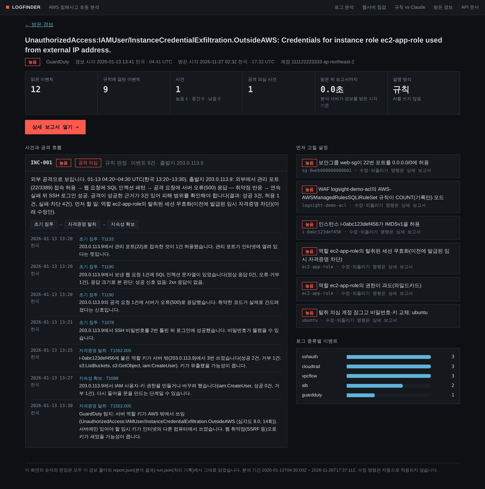

# 관리자 대시보드: 알림 → 경보 요약 → 상세 보고서

멘토링(11/26)에서 나온 흐름의 첫 초안이다. 디스코드·슬랙·이메일 알림의 링크를 누르면 웹에서 경보 요약 화면이 열리고,
거기서 기존 상세 보고서로 들어간다. 시각화·관리자 맞춤 설정은 이 흐름이 돈 뒤에 붙인다.

    알림(디스코드 카드 제목·슬랙 글·메일 본문의 "대시보드:" 주소)
      → /alerts/<경보 폴더>          한눈 요약: 등급, 숫자, 사건별 공격 흐름, 먼저 고칠 설정, 로그 종류별 이벤트, 알림 보낸 곳
      → /alerts/<경보 폴더>/report   기존 상세 보고서(report.html, 수정·되돌리기 명령 포함)
    /alerts                          받은 경보 목록(등급으로 거르기)
    /alerts/sample                   합성 샘플 경보(공개 데모에서도 열림)

## 숫자는 어디서 오나

화면은 `logsight watch`·`on-alert`가 경보마다 만드는 폴더(`--out`, 기본 `reports/alerts/<폴더>`)의 파일만 읽는다.
새로 계산하거나 채워 넣는 값은 없다. 파일에 값이 없으면 "기록 없음"으로 보인다.

| 화면 | 파일·칸 |
| --- | --- |
| 읽은 이벤트, 규칙에 걸린 이벤트, 사건, 등급별 사건 수 | report.json `n_events`, `n_flagged`, `n_incidents`, `severity_counts` |
| 공격 의심 사건 | report.json `incident_index`에서 `verdict`가 attack인 사건 수 |
| 받은 뒤 보고서까지 | run.json `received_to_report_s` |
| 설명 방식(규칙/Claude) | report.json `explain_mode` |
| 사건 요약·공격 흐름·판정 | report.json `results[].report`(`summary`, `attack_flow`), `incident_index[].verdict` |
| 먼저 고칠 설정 | report.json `results[].checks[].title` |
| 로그 종류별 이벤트 | report.json `events_by_source` |
| 알림 보낸 곳 | run.json `notify_channels` |

"경보→보고서" 시간(run.json `alert_to_report_s`)은 보이지 않는다. 시험용 합성 경보는 경보 시각이 과거라 이 값이 몇 달로 나와
오해를 사기 때문이다. 실제 경보에서 이 값을 보이려면 그때 다시 정한다.

## 켜는 법

1. 분석 서버에서 웹앱을 띄운다. 경보 폴더 위치를 `LOGSIGHT_ALERTS_DIR`로 알려 준다(기본 `reports/alerts`).

       LOGSIGHT_TOKEN=<긴 무작위 값> LOGSIGHT_ALERTS_DIR=/var/logsight/alerts uvicorn app:app --host 0.0.0.0 --port 8000

2. 알림에 넣을 주소를 `notify.json`의 `dashboard_url`(또는 환경변수 `LOGSIGHT_DASHBOARD_URL`)에 적는다.

       {"dashboard_url": "https://logs.example.com", "channels": [...]}

   그러면 알림 끝 줄이 `대시보드: https://logs.example.com/alerts/<폴더>`가 되고, 디스코드 카드는 제목을 누르면 그 주소로 간다.
   `dashboard_url`이 없으면 예전처럼 서버 안 보고서 경로를 적는다.

## 누가 볼 수 있나(로그인)

경보 보고서에는 내부 IP·계정 이름이 들어 있어 업로드와 같은 규칙으로 막는다.

- `LOGSIGHT_TOKEN`이 있으면: 로그인한 브라우저만 본다. 알림 링크를 처음 누르면 `/login`으로 갔다가 토큰을 넣으면 원래 경보 화면으로
  돌아온다. 브라우저가 30일 기억한다(HttpOnly 쿠키). 알림 주소에는 토큰을 넣지 않는다(채팅방에 남기 때문).
- `LOGSIGHT_TOKEN`이 없으면: 이 컴퓨터(127.0.0.1)에서만 열린다. 알림 링크를 휴대폰에서 열려면 토큰을 켜야 한다.
- 공개 데모(`LOGSIGHT_DEMO=1`)는 디스크의 경보를 보여 주지 않고 `/alerts/sample`만 보여 준다.
- 경보 폴더 이름은 `20261104_142606_guardduty_2019c894` 형식만 받는다(다른 경로를 읽지 못하게).

## 아직 안 된 것

| 항목 | 상태 |
| --- | --- |
| 카카오톡 알림 | 알림톡은 사업자 등록·비즈니스 채널이 필요해 아직 미지원(`docs/통지.md`). 지금은 디스코드·슬랙·이메일 링크로 들어온다 |
| 관리자 맞춤 설정(보는 항목 고르기, 알림 기준 바꾸기) | 없음. 목록의 등급 거르기만 있다 |
| 여러 사용자·권한 나누기 | 없음. 토큰 하나를 같이 쓴다 |
| 시간 흐름 그림·공격 흐름 그래프 | 없음. 상세 보고서의 그림을 그대로 쓴다 |
| 실제 디스코드에서 링크 눌러 보기 | 아직. 형식은 `tests/test_dashboard.py`로 시험 |

시험: `tests/test_dashboard.py`. 샘플 경보를 실제로 분석(AI 끔)해 폴더를 만들고, 화면 숫자가 report.json과 같은지,
폴더 이름 조작·다른 사이트로 보내는 `next`가 막히는지, 토큰 로그인 흐름을 본다.
