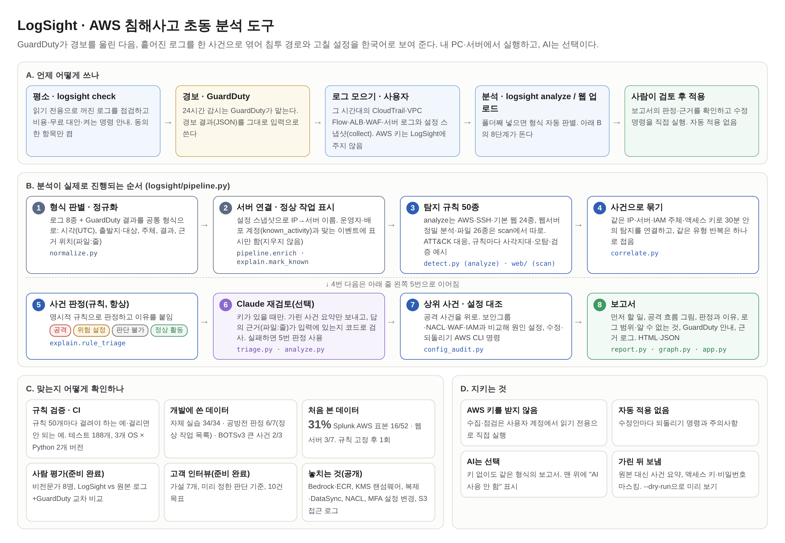

# LogSight 중간보고 발표 자료 (2026-11-01 기준)

> 구조도, 3분 시연 순서, 측정값, 예상 질문을 한 문서에 모았다. 숫자의 근거는 [중간보고_구현요약.md](중간보고_구현요약.md)와 [정규화_점검.md](정규화_점검.md)에 있다.

## 1. 한 문장 소개

**흩어진 AWS·서버 로그를 하나의 공격 흐름으로 엮어 한국어로 설명하고, 원인이 된 방화벽·권한 설정과 고치는 명령까지 제안하는 도구.**

- 문제: 작은 팀은 보안 담당자가 없고, 로그가 CloudTrail·VPC Flow·WAF·서버 로그로 흩어져 있어 "무슨 일이 있었고 무엇을 고쳐야 하는지"를 알기 어렵다. 로그 자체를 안 켠 경우도 많다(추정).
- 해결: ① 로그가 켜져 있는지 점검하고, 돈이 드는 로그는 무료 대안으로 대신한다. ② 8종 로그를 공통 형식으로 맞춰 사건 단위로 묶는다. ③ 설정 스냅샷과 대조해 원인 설정과 적용·되돌리기 명령을 만든다. ④ Claude가 근거(파일:줄)를 붙여 설명하고, 근거는 코드로 다시 검증한다.
- 원칙: 원본 로그를 AI에 통째로 보내지 않는다. 수정안은 자동 적용하지 않는다.
- 위치: **GuardDuty 대신이 아니라 GuardDuty 다음.** GuardDuty는 켜기 전의 일과 ALB·WAF·서버 로그를 보지 않는다(공방전에서도 공격이 끝난 뒤 켜져 결과 0건). 경보가 울린 날 LogSight가 이 로그들까지 엮어 침투 경로와 고칠 설정을 찾고, 평소에는 `logsight check`로 그때 필요한 로그가 켜져 있는지 점검한다. 근거: [GuardDuty_비교.md](GuardDuty_비교.md), [GuardDuty가_못보는것.md](GuardDuty가_못보는것.md)

## 2. 구조도

| 순서 | 하는 일 | 파일 |
| --- | --- | --- |
| 1. 정규화 | 로그 8종 + GuardDuty 결과의 형식을 자동 판별해 공통 형식(시각 UTC, 출발지·대상, 주체, 결과, 근거 위치)으로 | `logsight/normalize.py` |
| 2. 서버 연결·정상 작업 표시 | 설정 스냅샷으로 IP→서버 이름, 운영자·배포 계정 이벤트에 표시만(지우지 않음) | `logsight/pipeline.py`, `logsight/explain.py` |
| 3. 탐지 | 규칙 50종: analyze는 AWS·SSH·기본 웹 24종, 웹서버 정밀 분석·파일 26종은 `scan`에서 따로. ATT&CK 대응 | `logsight/detect.py`, `logsight/web/` |
| 4. 사건 묶기 | IP·서버·IAM 주체·액세스 키로 30분 안의 탐지를 연결, 반복은 하나로 | `logsight/correlate.py` |
| 5. 사건 판정(항상) | 규칙으로 공격 / 위험 설정 / 판단 불가 / 정상 활동과 이유 | `logsight/explain.py` |
| 6. Claude 재검토(선택) | 가린 요약만 보내고 근거(파일:줄) 검사, 실패하면 5번 판정 | `logsight/triage.py`, `logsight/analyze.py` |
| 7. 설정 대조 | 상위 사건을 보안그룹·NACL·WAF·IAM과 비교해 원인·수정·되돌리기 명령 | `logsight/config_audit.py` |
| 8. 보고서 | HTML·JSON, 웹 업로드 | `logsight/report.py`, `logsight/graph.py`, `app.py` |

## 3. 3분 시연 순서

준비: `uvicorn app:app` 실행 후 브라우저에서 `http://127.0.0.1:8000`. 인터넷·AWS 계정 없이 된다.

| 시간 | 화면 | 말할 것 |
| --- | --- | --- |
| 0:00~0:20 | 업로드 화면 ([demo1](img/demo1_upload.png)) | "로그 종류를 몰라도 폴더째 올리면 됩니다. CloudTrail부터 nginx까지 8종을 자동으로 알아봅니다." `samples/combined`의 파일을 모두 고르고 분석 |
| 0:20~0:50 | 보고서 첫 화면 ([demo2](img/demo2_summary.png)) | "맨 위에 'AI 사용 안 함'이 보입니다. 이 보고서는 로그를 밖으로 보내지 않고 만들었습니다. 로그 87줄에서 사건 3건, 모두 공격 의심입니다. '먼저 할 일'의 첫 줄, SSH 포트를 전 세계에 연 설정부터 닫으라고 합니다." |
| 0:50~1:40 | 공격 흐름 그림 ([demo8](img/demo8_attack_flow.png)), 단계별 설명 ([demo3](img/demo3_flow.png)) | "같은 IP가 웹을 훑고, SSH 비밀번호를 두 번 틀린 뒤 로그인하고, 서버 역할 키로 S3를 읽고, 사용자를 만들려다 막혔습니다. 그림의 선 6개는 모두 로그 줄에서 나왔고, 번호 표의 근거를 누르면 원본 줄로 갑니다. 아래 문장으로 이 사건 이벤트 10건이 모두 그림에 들어갔는지 다시 맞춰 봤다고 적혀 있습니다. 로그에 이어진 기록이 없는 곳(웹 서비스와 서버)은 선으로 잇지 않았습니다." |
| 1:40~2:10 | 원인과 수정안 ([demo4](img/demo4_fix.png)) | "왜 뚫렸는지(원인 설정), 무엇으로 바꿀지(현재 → 제안), 실행할 명령과 되돌리는 명령까지 나옵니다. 자동으로 바꾸지는 않습니다. 사람이 검토하고 적용합니다." |
| 2:10~2:25 | 로그 범위 ([demo6](img/demo6_coverage.png)) | "어떤 로그가 언제까지 있는지 막대로 보입니다(화면은 공방전 로그). VPC Flow가 없어서 데이터가 나갔는지는 알 수 없다고 먼저 말해 줍니다. '기록 없음'을 '안전함'으로 착각하지 않게 합니다." |
| 2:25~2:40 | 근거 이벤트 표 ([demo5](img/demo5_evidence.png)) | "로그마다 다르게 적힌 결과(ACCEPT, BLOCK, Success)를 허용·차단·성공·실패로 맞췄고, 공격받은 서버 ID까지 찾아 줍니다." |
| 2:40~3:00 | 터미널: `python -m logsight check` 예시 ([check_example.txt](../reports/check/check_example.txt)) | "애초에 로그가 꺼져 있으면 분석할 수 없습니다. 무엇이 꺼졌는지, 켜면 한 달에 얼마인지, 무료 대안은 무엇인지 알려 줍니다." |

시연이 끊길 때를 대비한 정적 결과: [reports/combined/report.html](../reports/combined/report.html)(브라우저로 바로 열림).

## 4. 측정값

| 항목 | 값 | 비고 |
| --- | --- | --- |
| 지원 로그 | 8종(CloudTrail, VPC Flow, WAF, ALB, GuardDuty, SSH, 서버 방화벽, nginx/apache) | 형식 자동 판별 |
| 탐지 규칙 | 50종(AWS·SSH 24, 웹서버 로그·파일 26) + GuardDuty 결과 연결 | 규칙마다 사각지대·오탐·검증 예시: [규칙_명세.md](규칙_명세.md) |
| 8종 통합 샘플(합성 87줄) | 사건 3건. 높음 사건 하나에 로그 5종이 엮이고 대상 서버까지 표시 | `samples/combined` |
| 무료 대안 로그만(합성 72줄) | 탐지 4종 → 사건 1건, 수정안 3개, 정상 사용자 15명 제외 | `samples/free` |
| 공개 데이터 flaws.cloud(1,939,207건) | 1분 41초, 메모리 2.7GB. 사건 1,871건 → 반복 묶으면 1,480건 | 처음 13분 47초·7.3GB에서 개선 |
| 정상 CloudTrail 20만 건 | 약 13초, 메모리 약 200MB | 처리 속도 측정용 |
| AI 입력 크기 | 사건당 약 6.5천~7.5천 자 | 원본 대신 축약 이벤트 + 맥락 집계 |
| 로그를 켰을 때 월 비용(서울) | CloudTrail 0달러, Flow Logs(S3) 약 0.3달러, WAF 약 8.6달러 | `logsight cost` 어림셈 |
| 테스트 | 188개(규칙 50개 양성·음성 검증 포함), Windows·macOS·Linux × Python 3.10/3.13 | GitHub Actions |

### 정확도: 개발에 쓴 데이터와 처음 본 데이터를 나눠서

| 데이터 | 처음 봤나 | 결과 |
| --- | --- | --- |
| 자체 실습 환경 | 아니오(시나리오를 우리가 만듦) | 34/34 단계 |
| 클라우드 공방전 로그 | 아니오(측정 뒤 수정) | 사건 판정 4/7, 정상 작업 목록 넣으면 6/7 |
| BOTSv3 실제 AWS 계정 | 아니오(측정 뒤 수정) | 큰 사건 3개 중 2개 |
| AIT-LDS 웹서버 | **예** | 공격 단계 3/7(스캔만 잡고 침투는 놓침) |
| Splunk attack_data AWS 표본 | **예**(규칙 고정 후 1회) | 행동 52개 중 16개 맞게 탐지(31%), 8개는 다른 이유로만 걸림 |

- **처음 본 데이터에서의 실력은 31%와 3/7이다.** IAM 변경, 로그 끄기, 스냅샷 공유, 권한 탐색, S3 대량 읽기 같은 핵심 길목은 잡고, Bedrock·ECR 같은 새 서비스, 랜섬웨어(KMS), MFA·비밀번호 정책 변경은 못 잡는다. 근거: [처음보는데이터_측정.md](처음보는데이터_측정.md)
- 사람이 실제로 더 잘 판단하는지는 아직 재지 않았다. 교차 설계 실험을 준비했다: [사용자평가/설계.md](사용자평가/설계.md)

### AI 없이(규칙) vs Claude: 실제 공방전 로그 ([demo7](img/demo7_compare.png), 웹 `/compare`)

| 설명 방식 | 판정 맞음(7건) | 첫 공격 사건 순위 | 로그 외부 전송 |
| --- | --- | --- | --- |
| 규칙만 | 4/7 | 2위 | 없음 |
| 규칙 + 정상 작업 목록(블루팀 계정 이름 한 줄) | 6/7 | 1위 | 없음 |
| Claude | 7/7 (3회 동일) | 1위 | 가린 사건 요약만 |

- 정상 작업 목록은 규칙을 이 데이터에 맞춰 고친 것이 아니라, 운영자가 미리 아는 자기 계정 이름을 설정에 적은 것이다.
- 규칙이 끝까지 못 맞힌 사건은 EKS 노드 역할 키가 다른 IP에서 신원 확인만 한 경우다. 규칙은 "판단 불가"로 두고 사람에게 넘기며, Claude는 정상으로 맞혔다.
- 그래서 구조는 "AI 없이도 끝까지 동작하는 기본 모드 + 원할 때 켜는 Claude"다. 근거: `reports/ctf/gongbang_rules_v3*.json`, `gongbang_ai_v2.json`.

## 5. 예상 질문과 답

| 질문 | 답 |
| --- | --- |
| 정확도는? | 개발에 쓴 데이터와 처음 본 데이터를 나눠 낸다. 규칙을 고정하고 처음 본 Splunk의 AWS 공격 표본 52개 중 16개(31%)를 맞게 잡았고, 웹서버 공개 데이터에서는 7단계 중 3단계였다. 개발 데이터의 높은 점수(34/34, 6/7)는 실력이 아니라 의도대로 동작한다는 뜻이다. |
| GuardDuty·Security Hub와 무엇이 다른가? | 그것들은 "탐지"를 한다. LogSight는 탐지 결과와 여러 로그를 하나의 흐름으로 묶고, 원인 설정과 고치는 명령을 한국어로 준다. GuardDuty 결과를 입력으로 받는다. |
| AI 없이도 되나? | 된다. 키가 없으면 규칙 판정과 문장 틀로 같은 형식의 보고서를 만들고, 맨 위에 "AI 사용 안 함"을 표시한다. 공방전에서 정상 작업 목록을 넣으면 6/7, Claude는 7/7이었다. |
| AI가 지어내면? | AI가 든 근거(파일:줄)가 실제 입력에 있는지 코드로 검사해, 없는 근거는 따로 표시한다. AI 없이도 같은 형식의 보고서가 나온다. |
| 로그를 AI에 보내도 되나? | 원본은 보내지 않는다. 사건별 축약본만, 액세스 키·비밀번호를 가린 뒤 보낸다. 보낼 내용을 `--dry-run`으로 미리 볼 수 있다. |
| GuardDuty만 쓰면 되지 않나? | 경보는 GuardDuty가 맞다. 켜 두기를 권한다. GuardDuty는 "키가 밖에서 쓰였다"는 알려 주지만 웹으로 어떻게 들어왔는지, 어느 설정을 고칠지는 모른다. 공방전에서 웹 단계 3개는 GuardDuty 데이터 밖이었다. LogSight는 GuardDuty 결과를 입력으로 받아 그 빈칸을 채운다. |
| 돈이 많이 드나? | 분석 도구는 무료. 로그를 켜는 비용은 WAF를 빼면 월 1달러 이하(어림셈). WAF 대신 nginx 로그로도 웹 공격을 찾는다. |
| 잘못 고치면? | 자동 적용하지 않는다. 수정안마다 되돌리기 명령과 주의사항이 붙는다. |

## 6. 아직 못 한 것과 2단계

- 시연 화면은 규칙 기반 설명이다. Claude 결과는 공방전 측정(판정 7/7)으로만 있고, 시연 데이터의 Claude 설명은 API 키를 받은 뒤 넣는다.
- 정확도 측정(정답 있는 데이터)과 실제 AWS 계정 실행이 남았다. 비용 계획: [AWS_비용_계획.md](AWS_비용_계획.md).
- 2단계 순서: 실제 AI 분석과 팀원 채점 → 실습 계정 공격 재현으로 정확도 측정 → 실제 GuardDuty·웹 서버 로그로 검증.
- 장기: **GuardDuty 결과 하나로 시작하기.** 결과 ID를 넣으면 그 시간대·IP·인스턴스에 맞는 CloudTrail·ALB·WAF·서버 로그를 읽기 전용 권한으로 찾아 모은 뒤 분석한다. 지금은 사용자가 로그 파일을 직접 모아야 한다.
